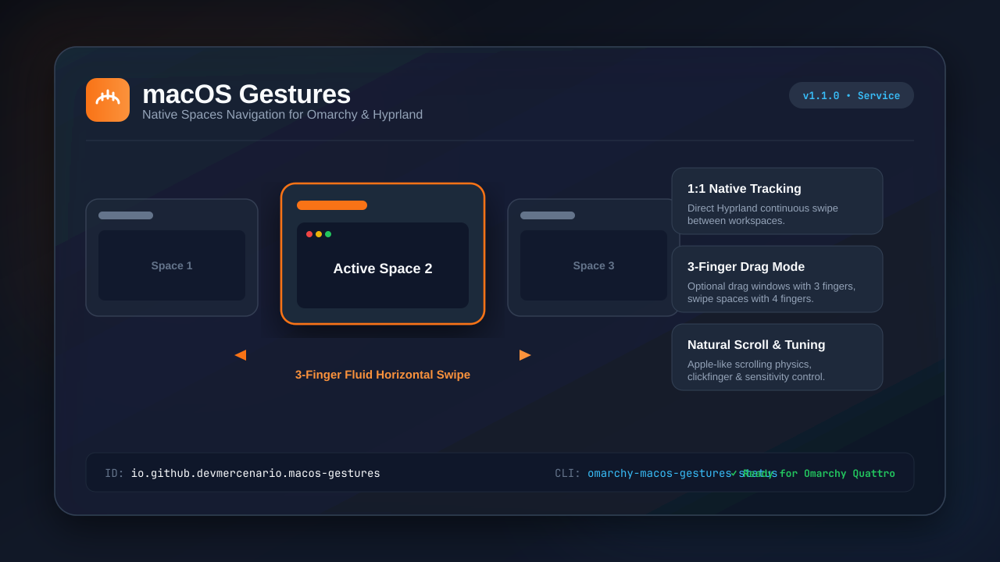

# macOS Gestures for Omarchy

Native **macOS-style Horizontal Workspace Gestures** (Spaces swipe) for **Omarchy Linux** (Hyprland + Quickshell Quattro).



---

## 📋 Overview

**macOS Gestures** brings Apple's fluid trackpad workspace navigation to Omarchy:

1. **Fluid 1:1 Horizontal Tracking**: Hyprland's native C++ workspace swipe engine (`CWorkspaceSwipeGesture`) delivers continuous, inertial transitions between workspaces that directly follow your finger motion.
2. **Two Workflow Modes**:
   - **Standard Mode**: 3-finger horizontal swipe to switch workspaces (default).
   - **3-Finger Drag Mode (`drag3fg`)**: 3 fingers drag windows natively (`drag_3fg = 1`), while workspace navigation seamlessly switches to 4-finger horizontal swipes—matching macOS behavior.
3. **Apple-style Touchpad Mechanics**: Natural scrolling, clickfinger behavior (two-finger right-click), and calibrated sensitivity.
4. **Zero Overhead**: Fully integrates with Hyprland's Lua gesture API and Quickshell's background service architecture.

---

## 🖐️ Gesture Matrix

| Gesture | Action | Implementation |
| :--- | :--- | :--- |
| **3-Finger Swipe (Left / Right)** | Switch spaces / workspaces (1:1 continuous) | `hl.gesture({ fingers = 3, direction = "horizontal", action = "workspace" })` |
| **4-Finger Swipe (Left / Right)** | Switch spaces (when 3-finger drag is active) | `hl.gesture({ fingers = 4, direction = "horizontal", action = "workspace" })` |
| **3-Finger Window Drag** | Drag active window under cursor (in `drag3fg` mode) | `hl.config({ input = { touchpad = { drag_3fg = 1 } } })` |
| **2-Finger Scroll** | Natural scrolling (content follows fingers) | `touchpad.natural_scroll = true` |
| **2-Finger Tap / Click** | Secondary click (Right-click) | `touchpad.clickfinger_behavior = true` |

---

## 📦 Installation

### From Omarchy Marketplace / Plugin Manager

```bash
omarchy plugin add https://github.com/jlordcode-oss/omarchy-macos-gestures
```

### Manual Installation

```bash
git clone https://github.com/jlordcode-oss/omarchy-macos-gestures.git
cd omarchy-macos-gestures
./scripts/install.sh
```

The plugin automatically configures `~/.config/hypr/macos_gestures.lua` and reloads Hyprland seamlessly.

---

## 🗑️ Removal

```bash
omarchy plugin remove io.github.devmercenario.macos-gestures
```

Or run the uninstaller script:

```bash
./scripts/uninstall.sh
```

---

## 🛠️ CLI Usage

The included CLI helper `omarchy-macos-gestures` allows instant configuration:

```bash
# Check current status and active profile
omarchy-macos-gestures status

# Output status in JSON format
omarchy-macos-gestures status --json

# Set Standard profile (3-finger horizontal swipe)
omarchy-macos-gestures mode standard

# Set 3-Finger Drag profile (3-finger drag + 4-finger horizontal swipe)
omarchy-macos-gestures mode drag3fg

# Toggle or set natural scrolling
omarchy-macos-gestures natural-scroll toggle
omarchy-macos-gestures natural-scroll on
omarchy-macos-gestures natural-scroll off

# Enable or disable gestures
omarchy-macos-gestures disable
omarchy-macos-gestures enable

# Force re-sync with Hyprland
omarchy-macos-gestures sync
```

---

## 🔌 IPC Interface

The plugin exposes an IPC handler on Omarchy's shell bus (`io.github.devmercenario.macos-gestures`):

```bash
omarchy-shell io.github.devmercenario.macos-gestures status
omarchy-shell io.github.devmercenario.macos-gestures setMode standard
omarchy-shell io.github.devmercenario.macos-gestures setMode drag3fg
omarchy-shell io.github.devmercenario.macos-gestures sync
```

---

## 🔒 Security & Privilege Policy

- **No sudo or pkexec is required.** The plugin runs entirely with normal user permissions within Omarchy and Hyprland.
- **No external daemons or background processes**: All logic runs either inside the native Omarchy Quickshell process or direct compositor calls.
- **No telemetry or network calls**: Completely offline and privacy-first.

---

## 📄 License

MIT License. Copyright (c) 2026 devmercenario / Omarchy Contributors.
