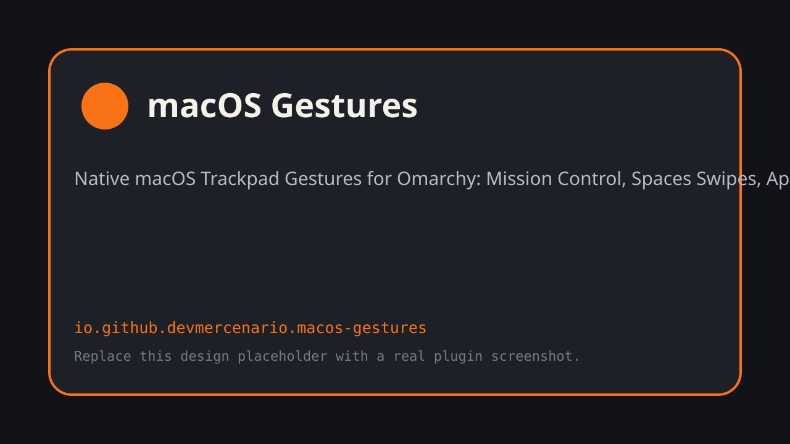

# macOS Gestures for Omarchy

Gestos nativos de Trackpad estilo **macOS** para **Omarchy Linux** (Hyprland 0.56 + Quickshell Quattro).



---

## 📋 Resumen de la Investigación y Viabilidad

Tras una investigación exhaustiva del kernel Linux (`libinput`), la arquitectura del compositor Wayland (**Hyprland 0.56.2** sobre Aquamarine) y el shell de escritorio (**Omarchy 4 Quattro / Quickshell**):

1. **Viabilidad 100% Confirmada**: Hyprland cuenta con soporte nativo de gestos multitáctiles en C++ (`CTrackpadGestures`), expuestos a través de la API Lua `hl.gesture`.
2. **Física Fluida 1:1**: Hyprland ejecuta un seguimiento continuo e inercial (`CWorkspaceSwipeGesture`) idéntico al comportamiento de macOS Spaces.
3. **Resolución de Conflictos (3 dedos vs 4 dedos)**: En macOS, cuando se activa el arrastre con tres dedos (*Three-Finger Drag*), los gestos de navegación conmutan a 4 dedos. Este plugin replica exactamente esta lógica a través de dos modos operativos:
   - **Modo Standard**: Swipes de 3 dedos para cambiar espacios y Mission Control.
   - **Modo Drag3fg**: Arrastre nativo con 3 dedos (`drag_3fg = 1`) y navegación con 4 dedos.
4. **Mission Control Nativo**: Se implementa un overlay de pantalla completa en Quickshell (`Overlay.qml`) con previsualización de ventanas, organización por espacios, filtrado rápido por teclado y selección inmediata.
5. **Reutilización del Ecosistema**: Launchpad aprovecha directamente la cuadrícula de aplicaciones oficial de Omarchy (`omarchy.dock apps`) y el Centro de Notificaciones utiliza el historial del shell.

---

## 🖐️ Matriz de Gestos

| Gesto macOS | Función en macOS | Equivalente en Omarchy | Implementación Técnica |
| :--- | :--- | :--- | :--- |
| **Deslizar 3/4 dedos (horizontal)** | Cambiar entre escritorios / apps pantalla completa | Transición 1:1 entre Workspaces | `hl.gesture({ fingers = 3/4, direction = "horizontal", action = "workspace" })` |
| **Deslizar 3/4 dedos (hacia arriba)** | **Mission Control** | Overlay panorámico de ventanas y espacios | Invocación de `Overlay.qml` vía IPC Quickshell |
| **Deslizar 3/4 dedos (hacia abajo)** | **App Exposé** | Ventanas de la aplicación activa | `Overlay.qml` en modo App Exposé |
| **Pellizco con 4 dedos (hacia adentro)** | **Launchpad** | Parrilla de aplicaciones de Omarchy | Invocación de `omarchy-shell omarchy.dock apps` |
| **Separar 4 dedos (hacia afuera)** | **Mostrar Escritorio** | Ocultar ventanas y mostrar escritorio limpio | Toggle de espacio de trabajo especial `desktop` |
| **Arrastrar con 3 dedos** | Arrastrar ventanas y seleccionar texto | Three-finger drag en libinput | `hl.config({ input = { touchpad = { drag_3fg = 1 } } })` |
| **Desplazamiento con 2 dedos** | Desplazamiento natural (*Natural Scrolling*) | Scroll en dirección del movimiento | `touchpad.natural_scroll = true` |
| **Pulsar con 2 dedos** | Clic secundario | Clic derecho con dos dedos | `touchpad.clickfinger_behavior = true` |
| **Pellizcar con 2 dedos** | Zoom en apps | Zoom nativo Wayland en clientes | Protocolo Wayland `zwp_pointer_gestures_v1` |

---

## 🏗️ Arquitectura del Plugin

El plugin está estructurado bajo el estándar modular de **Omarchy Quattro**:

```
omarchy-macos-gestures/
├── manifest.json              # Manifiesto schemaVersion 1 (kinds: service, overlay)
├── Service.qml                # Servicio en segundo plano con IpcHandler y sincronización
├── Overlay.qml                # Overlay de Mission Control y App Exposé (Quickshell)
├── bin/
│   └── omarchy-macos-gestures # Herramienta CLI de gestión
├── scripts/
│   ├── macos_gestures_manager.py # Generador reactivo de configuración Hyprland Lua
│   └── validate_manifest.py     # Validador portátil de manifiesto
├── tests/
│   ├── run                    # Suite de verificación y validación oficial
│   └── test_gestures.py       # Pruebas unitarias de sintaxis Lua y perfiles
├── install.sh                 # Instalador seguro para Omarchy
└── uninstall.sh               # Desinstalador limpio
```

---

## 🚀 Instalación Rápida

Para instalar y habilitar el plugin en tu entorno Omarchy:

```bash
git clone https://github.com/devmercenario/omarchy-macos-gestures.git
cd omarchy-macos-gestures
./install.sh
```

El instalador:
1. Ejecuta la suite de pruebas unitarias y validación con `omarchy plugin validate`.
2. Instala los componentes en `~/.config/omarchy/plugins/io.github.devmercenario.macos-gestures/`.
3. Crea el enlace del comando CLI `omarchy-macos-gestures` en `~/.local/bin/`.
4. Habilita el plugin en el shell de Omarchy y sincroniza los gestos en `~/.config/hypr/macos_gestures.lua`.
5. Recarga Hyprland de forma transparente sin interrupciones.

---

## 🛠️ Uso y Comandos CLI

El comando `omarchy-macos-gestures` permite controlar todos los aspectos de los gestos:

```bash
# Ver el estado actual, perfil activo y configuración de dedos
omarchy-macos-gestures status

# Salida en formato JSON para scripts o integraciones
omarchy-macos-gestures status --json

# Cambiar al perfil estándar (3 dedos para navegar, 4 dedos para Launchpad)
omarchy-macos-gestures mode standard

# Cambiar al perfil con arrastre de 3 dedos (3 dedos para drag, 4 dedos para navegar)
omarchy-macos-gestures mode drag3fg

# Alternar o configurar desplazamiento natural
omarchy-macos-gestures natural-scroll toggle

# Abrir Mission Control directamente desde terminal o atajo
omarchy-macos-gestures mission-control

# Abrir App Exposé para la ventana actual
omarchy-macos-gestures app-expose

# Deshabilitar o habilitar temporalmente los gestos
omarchy-macos-gestures toggle
```

---

## 🧪 Pruebas y Control de Calidad

Para ejecutar la suite de pruebas:

```bash
./tests/run
```

Resultado verificado:
- Validación de esquema `manifest.json`.
- Pruebas sintácticas de Lua mediante `luac -p`.
- Validación oficial mediante `omarchy plugin validate`.
- Verificación de ausencia de errores en Hyprland mediante `hyprctl configerrors`.

---

## 📄 Licencia

MIT © devmercenario
